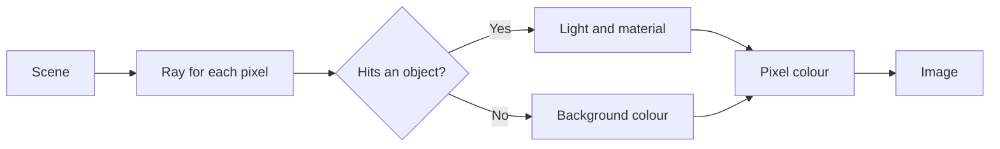
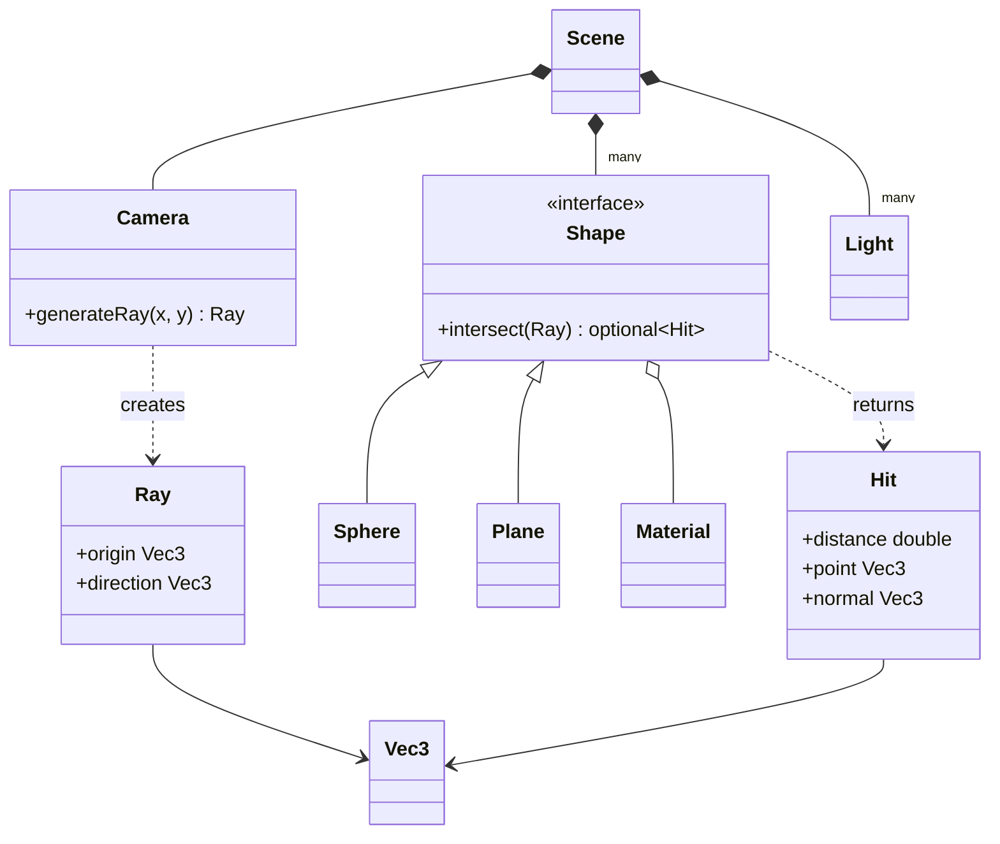

# Discovery report

## Problem statement

A Los Angeles animation studio needs rendering software that its own team can understand, trust and adapt, so that it can deliver full-length films on time, but its last renderer produced defects that nobody could explain once its author had left, and the commercial alternative is too expensive and too closed to meet its needs.

## Client interview summary

### Fast previews for designers

**Need:** Designers must be able to see the result of their work quickly, on their own desktop machine, without waiting for a full-quality render. A preview does not have to be perfect, but it must be accurate enough for them to judge their scene and keep working.

> **Q (colleague):** "What kind of hardware specs do you have?"
>
> **A (client):** "One is the designer, so the graphiste, who will have a desktop machine that is pretty powerful."
>
> **A (client):** "In this case, you can expect to produce a smaller image so they can have a preview of what they're rendering."

> **Q (colleague):** "How many pre-renders do you usually do?"
>
> **A (client):** "Typically, at least 10 different pre-renders per image. So the average workflow is about 10 pre-renders per image before the final render."

**My conclusion:** Previews are the most frequent use of the renderer: every image is rendered at least ten times before its final version. Early in the interview, the client described the situation they want to avoid: designers who "start the render, they go outside, smoke a cigarette, and then they come back inside", which they called "a big no-no". Later they added that "for the designer, a fast image which is pretty accurate is very important". The renderer therefore needs a preview mode, with a smaller image and lighter quality settings, that gives a result in seconds on a designer's desktop. Preview time is a key number to measure in every version.

### Type of content and final image quality

**Need:** The renderer is for full computer-animated feature films. The final images, the ones that go into the film, must be high quality, even if they take longer to render than previews.

> **Q (colleague):** "Can you tell me what kind of content you render, such as full animation or live-action visual effects?"
>
> **A (client):** "It's mainly full animation, and I'd say the most similar is Toy Story."

**My conclusion:** The target is stylised 3D animation, not photorealistic visual effects mixed with live footage. The client was clear that the final render is about quality: "in the final scene, a high-quality image is very important", and "we are seeking an image, not a fast image". Together with the previous theme, this means one engine with two configurations, fast for previews and high quality for the final render. Quality must be controlled through render parameters, not through two separate pieces of code, so that previews always reflect what the final image will look like.

### Rendering a full film within two months

**Need:** Once the creative work is finished, the whole film must be rendered within two months. The film is a 90-minute feature.

> **Q (colleague):** "You said you need to render in two months, but how big is your project?"
>
> **A (client):** "It's a 90-minute feature film."

> **Q (colleague):** "What must the software be able to do?"
>
> **A (client):** "It must have the full ray tracer capable of producing images for a full film within a 2-month period."

**My conclusion:** The client also said "we render 24 frames per second" and that their render farm has "up to one hundred machines". A 90-minute film is 90 × 60 × 24 = 129,600 frames. Two months is about 60 days, or 5,184,000 seconds. With 100 machines working in parallel, that gives 518,400,000 machine-seconds, which is about 4,000 seconds, or 67 minutes, per final frame on one machine. This is an upper limit: it assumes the farm runs day and night, renders nothing else, and never has to re-render a frame. In practice the real target must be lower. Render time per frame is therefore a hard requirement, and it must be measured and tracked from the first version.

### CPU-only hardware

**Need:** All rendering, both previews and final images, must run on CPUs. The client has no graphics cards on the render farm.

> **Q (colleague):** "What kind of hardware specs do you have?"
>
> **A (client):** "And then on the other side is the actual production renderer, which is a larger machine that has a reasonable amount of specs. We don't have graphics cards, so everything must be rendered by the CPU."

**My conclusion:** Any solution based on GPU rendering is ruled out. Performance has to come from the CPU itself: using every core with multithreading, organising data so it stays in the processor cache, and using efficient algorithms and acceleration structures to avoid useless work. This choice also affects the state of the art, since some existing renderers depend on GPUs.

### Reliable and explainable images

**Need:** The renderer must be predictable: the same scene must always produce the same image. When an image has a defect, the team must be able to find out why it happened and how to fix it.

> **Q (colleague):** "Can you walk me through the last time you rendered a project?"
>
> **A (client):** "We had a big project to bring to publication, and we kept finding that there were black artifacts in the images that were produced. And the rendering time doubled."
>
> **A (client):** "Our engineering team couldn't figure out why we were having these anomalies, plus it was going slower."

> **Q (colleague):** "What would show you that the software meets your needs?"
>
> **A (client):** "I think there are two elements. One is it produces a reliable image. So if I give it some inputs, I can always expect the same output."
>
> **A (client):** "Explain why there is an issue and what steps you can take to correct it."

**My conclusion:** These are the client's own acceptance criteria, so they matter more than any other feature. The client said the black spots were "our biggest frustration", because "nobody could tell us why". They also mentioned "2 types of fault", without describing the second one. To meet this need, the renderer must be deterministic, give clear error messages when a scene is invalid, and come with automated tests that compare rendered images with reference images. These tests should catch both visual defects, such as black spots, and performance problems, such as render time suddenly doubling.

### Lessons from the last project

**Need:** The client wants to stop depending on a commercial tool they cannot control. On their last project, unexplained defects forced them to buy an expensive licence, and they still delivered late.

> **Q (colleague):** "Can you walk me through the last time you rendered a project?"
>
> **A (client):** "And in the end, we ended up having to buy a commercial license that cost us a lot of money for a professional rendering system, and we deliver 3 weeks late."

**My conclusion:** The client described the full story. They had an in-house solution, then moved to a commercial one, Maya. With Maya, "we made a loss because the licenses were so expensive", "we had to sacrifice some features", and the tool "doesn't satisfy all the needs that we have for our future projects". Their main frustration is being limited: "you see only what Maya can produce". What they are really paying for is control: owning the code, understanding it and being able to change it. This is the strongest argument for building a new renderer rather than using an existing one.

### Simple scope now, extensible later

**Need:** The first version only has to render spheres and planes. However, requirements change with every project, so the renderer must make it easy to add new shapes and new effects over time.

> **Q (colleague):** "Do you have any requirements for the rendering features?"
>
> **A (client):** "So the requirements change constantly with every new project."
>
> **A (client):** "For the moment, let's just say we need to be able to render spheres, planes, and that's it for now."

> **Q (colleague):** "Which technique do you use the most?"
>
> **A (client):** "For the moment, we just started with the trial version, which is very basic."
>
> **A (client):** "But we would like the software to be able to include new effects, new shapes."

**My conclusion:** The client summed it up as "the main thing is the ability to add our own features". With Maya, a new feature either gets refused or "will take six months or a year". So the scope is small today, but the design must be ready to grow. Adding a new shape or effect should mean adding a new piece of code, not modifying the core of the renderer. This will directly shape the domain model and the architecture.

### Fit in the production pipeline

**Need:** The renderer is a black box with no user interface: it reads a description of a scene and outputs an image. It must fit into the client's existing workflow, between the designers' tool and the render farm.

> **Q (colleague):** "Do you want us to render frames, or to create them?"
>
> **A (client):** "So we just want to render. So it's a black box that takes a description of the scene and outputs an image."

**My conclusion:** The client explained the full workflow. Designers "use some third-party software to position the scene, to put objects in the scene and set up lighting", then "they'll save a file, and that file will be the input to your ray tracer". This file "is thrown to the render farm", with "no interface for it". The result "will just be saved to disk and then sequenced into a film". The input format is our choice, but "it must be a standardized format that we can understand". The product is therefore a command-line program: one scene file in, one image file per frame out, easy to launch automatically on many machines at once.

### Long-term in-house maintenance

**Need:** The client's own team must be able to maintain the renderer for many years. The software must stay understandable and debuggable even after the people who wrote it have left.

> **Q (colleague):** "Once the solution is delivered, who will maintain it, and what skills will they have in five years?"
>
> **A (client):** "So we would like to maintain the solution in-house, and we would like to be able to maintain it in the long term. So it must be a solution that is maintainable."

> **Q (colleague):** "Is there anything else that we might have missed?"
>
> **A (client):** "What happens when the person who wrote it leaves the team? This is something that really afflicted us last time, in that the person who wrote the software had left that team already, and we found these artifacts and no one could tell us why we had them."

**My conclusion:** This is the root cause of the last failure: "we had a team of 5 people, but the key person wrote it, and even the 5 people, they didn't know how to debug it". The client asked it directly: "Are we able to maintain it without you?" and "can the other team members continue to understand the logic of it?". Maintainability is therefore a requirement in its own right. The code must be readable, the design decisions must be written down, and automated tests must let a new developer change the code without fear. No part of the code should depend on a single person.

### Open source, partners and documentation

**Need:** The code will be open source, under the client's responsibility. Documentation is needed for two audiences: the developers who will take over the code, and the artists and technicians who will use the renderer and set up the render farms.

> **Q (colleague):** "Does any part of the code need to stay in-house?"
>
> **A (client):** "Currently, all will be open source."

> **Q (colleague):** "Who will read the documentation?"
>
> **A (client):** "We do have a development team which will take ownership of what you make for us, so there'll be technical people reading it. However, we expect some kind of user guide for the different artists or the people setting up the render farms."

**My conclusion:** The client relies on rendering partners who "have skill sets to contribute to this project" and who "will really be using the software and probably participating in its life". They want "responsibility in-house", but also "a way for them to contribute, create bugs, propose changes". This calls for a public repository with a clear contribution process: issues for bug reports, pull requests for changes, and code review before merging. The client also said they have no technical rules to impose: "we rely on you for that". Every technical choice is ours, so each one must be justified in writing.

### Cost, budget and deadline

**Need:** The client wants to replace commercial licences, which are charged per artist and per render machine, with a solution that is much cheaper in the long term.

> **Q (colleague):** "How much did you spend on rendering last year?"
>
> **A (client):** "We must have spent over $2 million for the licenses. Remember, the license is seat-based."
>
> **A (client):** "Per artist, plus every single node in our render farm we have to pay an individual license for, which is why this is a huge budget."
>
> **A (client):** "We'd like to in-house it and make it much more affordable."

**My conclusion:** The client set a budget of "no more than €500,000 on the project", which they described as "about one quarter" of the old licence cost, and they see it as a "very long-term" investment. The delivery date is fixed: "the software must be delivered by January 5th", so that "our team can start working on the production", and the partners "must be ready for the 5th of January". With a limited budget and a fixed date, the first version must be small and solid rather than large and fragile, and it must leave room to add features later.

### Open questions

- **Input format:** the client lets us choose, but wants "a standardized format". Which formats can their third-party tool export, and which tool do the designers use?
- **Output format and resolution:** a colleague asked whether the images are 4K, but got no clear answer. Image size has a direct effect on render time, so we need this number.
- **Preview speed:** the client wants previews to be fast, but gave no figure. How many seconds is acceptable for a designer?
- **Scope on 5 January:** the client said "spheres, planes, and that's it for now", but also "the full ray tracer capable of producing images for a full film within a 2-month period". These two statements do not describe the same product. Which one is expected on 5 January?
- **Speed versus quality:** the client said the team needs "to be able to get images really quickly", then "we are seeking an image, not a fast image". Our understanding is fast previews and high-quality final renders. This needs to be confirmed.
- **Same output:** must two renders be identical to the pixel, even on different machines or with a different number of threads? This affects how we use multithreading and randomness.
- **Open source and control:** "all will be open source", but also "responsibility in-house" and "I don't want to give up information voluntarily". Which licence should we use, and who decides which contributions are accepted?
- **Budget:** the licence cost was given as "$2 million", then as "€2 million". Which currency is right? The client also mentioned an extra budget for people to be hired. What is it for?
- **Past defects:** the client mentioned "2 types of fault" but only described the black spots. What was the second defect?
- **Previous in-house tool:** the client used to have an in-house solution before Maya. What did it do, and why was it abandoned?
- **Client brief:** the client referred us to their brief for more information. We need that document.
- **Not discussed:** materials, light types, the operating system used on the farm and on the desktops, and whether previews also run on the farm.

## State of the art

| Solution  | Maker                   | Licence     | Pricing (date checked)              | Capabilities                                 | Sources                     |
|-----------|-------------------------|-------------|-------------------------------------|----------------------------------------------|-----------------------------|
| Arnold    | Autodesk                | Proprietary | About $430/year (16 Nov 2026) (1)   | Film renderer, CPU and GPU                   | [SuperRenders Farm][arnold] |
| RenderMan | Pixar                   | Proprietary | $595 per licence (16 Nov 2026)      | Renderer for animated films                  | [Pixar][renderman]          |
| V-Ray     | Chaos                   | Proprietary | From €379.20/year (16 Nov 2026) (2) | CPU, GPU or hybrid                           | [Chaos][vray]               |
| Maya      | Autodesk                | Proprietary | About $2,010/year (16 Nov 2026) (1) | 3D suite, renders with Arnold                | [SuperRenders Farm][maya]   |
| Cycles    | Blender                 | Apache 2.0  | Free (16 Nov 2026)                  | Production renderer                          | [Cycles][cycles]            |
| pbrt-v4   | Pharr, Jakob, Humphreys | Apache 2.0  | Free (16 Nov 2026)                  | Reference renderer in C++17                  | [GitHub][pbrt]              |
| appleseed | appleseed community     | MIT         | Free (16 Nov 2026)                  | Renderer for animation and VFX               | [GitHub][appleseed]         |
| Embree    | Intel                   | Apache 2.0  | Free (16 Nov 2026)                  | CPU ray tracing library, not a full renderer | [Embree][embree]            |

(1) Autodesk's own price page was not reachable, so this price comes from a third-party source. Maya is the client's current tool.

(2) V-Ray Solo is €379.20/year and Premium is €565.44/year. The price of render node licences is not published.

[arnold]: https://superrendersfarm.com/article/arnold-renderer-complete-guide
[renderman]: https://renderman.pixar.com/upgrade-faq
[vray]: https://www.chaos.com/vray
[maya]: https://superrendersfarm.com/article/what-3d-software-costs-2026
[cycles]: https://www.cycles-renderer.org/
[pbrt]: https://github.com/mmp/pbrt-v4
[appleseed]: https://github.com/appleseedhq/appleseed
[embree]: https://www.embree.org/

**What I conclude:**

- **What they have in common:** all of them are mature, physically based renderers that already produce film-quality images.
- **Commercial tools:** they are paid per licence, so the cost grows with every artist and every render node. This is exactly how the client reached over $2 million. They are also closed: the client cannot add their own features.
- **Open-source tools:** they are free and can be modified, but they are large codebases built for other goals: research, teaching, GPU rendering or general-purpose 3D. A small in-house team would struggle to own them, which brings back the "key person" risk from the last project.
- **For this client:** no solution combines CPU-only rendering, a small and understandable codebase, easy extension and full ownership. This justifies building a new renderer. Embree could still be useful later as a building block to speed up ray intersections.

## What is ray tracing?

Ray tracing creates an image by following rays of light backwards, from the camera into the scene. **What goes in:** a scene with a camera, objects, materials and lights. **What comes out:** an image. **In between:** for each pixel, the program sends a ray and finds the first object it hits. It then checks if that point is lit by the lights and computes its colour. Mirrors and glass send new rays, which add their colour. If the ray hits nothing, the pixel gets the background colour. Each pixel is independent, so the work can be shared between many CPU cores and many machines.

**Sources:**

- Started from: [Ray Tracing in One Weekend](https://raytracing.github.io/), a free book series that builds a simple ray tracer step by step.
- Reference I would come back to: [Physically Based Rendering: From Theory to Implementation](https://pbr-book.org/), by Matt Pharr, Wenzel Jakob and Greg Humphreys, free online.

## What is C++?

### Programming paradigms

C++ is multi-paradigm: it lets me choose the right style for each problem. For this project I would use modern C++ (C++17 or later).

- **Procedural:** the program is a list of steps, written as functions. Example: a function that computes the dot product of two vectors.
- **Object-oriented:** data and the functions that use it are grouped in classes. Example: `Sphere` and `Plane` are two kinds of `Shape`.
- **Generic:** the same code works with different types, and the compiler checks it. Example: one `Vec3` type that works with `float` or `double`.
- **Functional:** small functions are passed to other functions. Example: sorting the hits of a ray by distance with a lambda.

**Compared with Python and JavaScript:**

- C++ is **compiled and statically typed**: many errors are found before the program runs.
- C++ has **no garbage collector**: I decide when memory is created and freed.
- Result: more speed and control, but more responsibility.

### What to watch out for

C++ leaves memory and safety to me. Classic traps:

- **Memory leaks:** memory allocated and never freed.
- **Dangling pointers:** using an object that no longer exists.
- **Undefined behaviour:** reading outside an array or using an uninitialised variable. No error, but random results later.
- **Floating-point precision:** a ray can hit its own surface again because of rounding errors, and a bad calculation can give `NaN`. Both produce black pixels, with no warning. This is one possible cause of the client's black spots.
- **Data races:** two threads changing the same data. The image changes between runs, which breaks the client's need for the same output every time.
- **Hidden copies:** passing big objects by value slows the program down without any warning.

**How to avoid them:** RAII (an object frees its own resources), smart pointers (`std::unique_ptr`), standard containers (`std::vector`), compiler warnings and sanitizers (AddressSanitizer, UndefinedBehaviorSanitizer).

### Shaping the domain model

The domain model is how the code represents the client's concepts: scene, camera, ray, shapes, materials and lights.

- **Small value types** for maths (`Vec3`, `Ray`, `Hit`, `Color`): simple, cheap to copy, used millions of times per image.
- **Polymorphism** for shapes: one `Shape` interface, so adding a new shape means adding a class without changing the renderer. This answers the client's need to add their own features.
- **No hit is a normal case:** `intersect` returns `std::optional<Hit>`, so "the ray missed" is explicit, with no magic value.
- **Clear ownership:** the scene owns its shapes through `std::unique_ptr`, so it is always clear who creates and destroys each object.
- **Composition over inheritance:** a shape *has* a material, instead of a "RedSphere" subclass. The model stays simple and easy to maintain.
- **Trade-off:** a virtual call has a small cost, and `intersect` runs millions of times per image. `std::variant` is a faster alternative but harder to extend. I would start with the interface, then measure before changing it.

**Sources:**

- Started from: [LearnCpp.com](https://www.learncpp.com/), a free step-by-step tutorial on modern C++.
- Reference I would come back to: [cppreference.com](https://en.cppreference.com/) for the language and the standard library, and the [C++ Core Guidelines](https://isocpp.github.io/CppCoreGuidelines/CppCoreGuidelines) by Bjarne Stroustrup and Herb Sutter for good practices.
