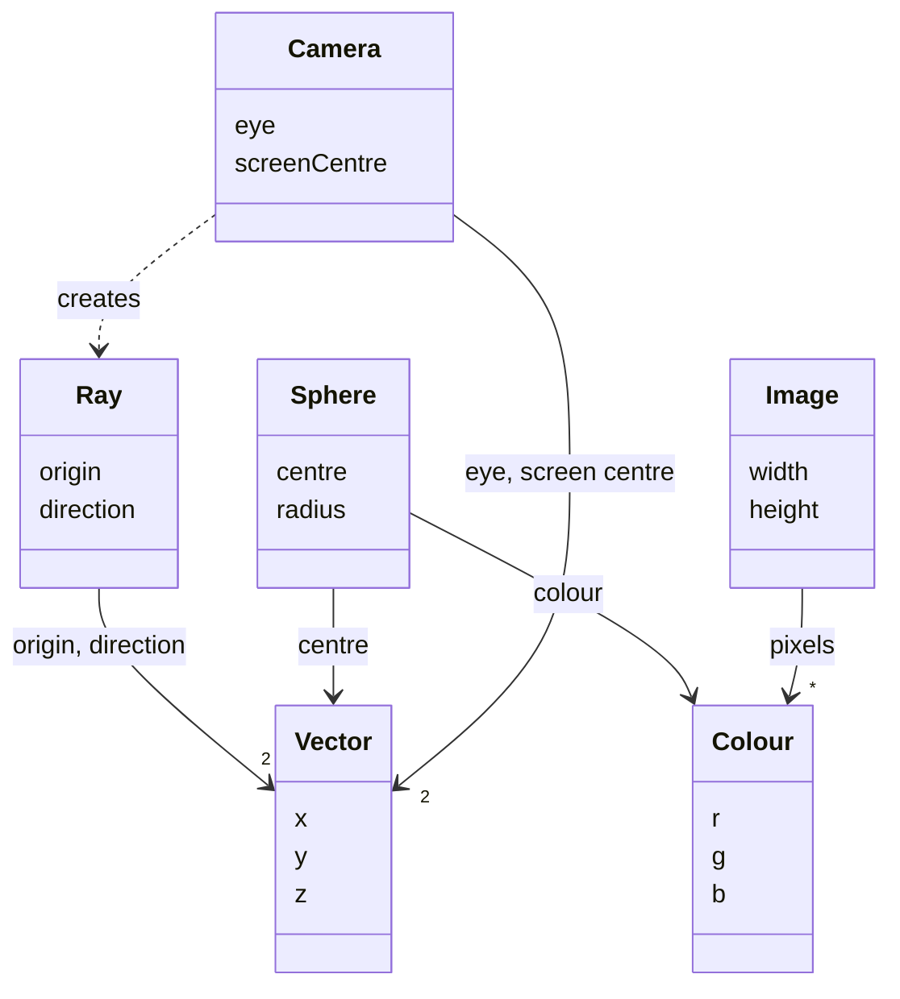

# Domain model

The concepts of the ray tracer and how they relate, in the client's words.
Methods are left out on purpose: this is about what each concept holds.

## Decisions recorded so far

- **Is a colour a vector?** No, see [ADR 0007](../adr/0007-colour-is-its-own-class.md).
- **Are a point and a direction the same class?** For now yes: both are a `Vector`.
  Revisit if mixing them up causes bugs.
- **Who decides the colour of a pixel?** For now the free function
  `trace(ray, sphere)` in `src/render/trace.h`: it returns the sphere's colour on a
  hit and black otherwise. It moved out of `main` so that it can be tested.

## Folder dependencies

`render/` → `geometry/` → `math/`, and `geometry/` → `colour/`. No cycles.
