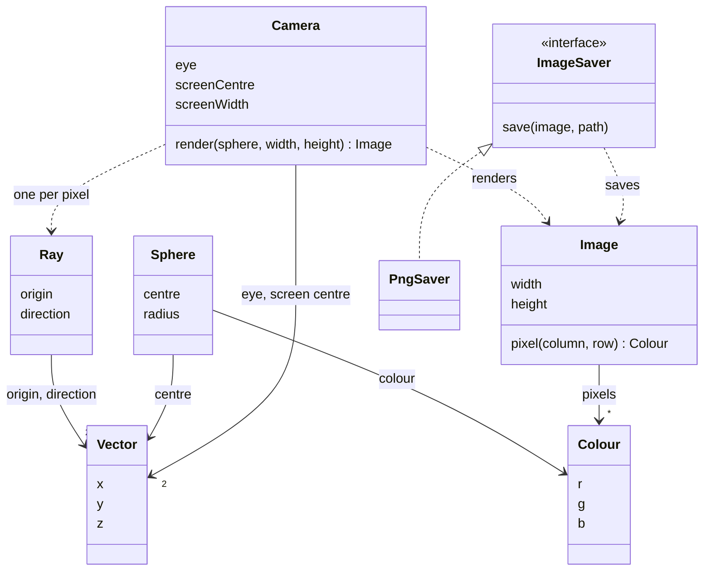

# Domain model

The concepts of the ray tracer and how they relate, in the client's words.
Methods are left out on purpose, except the few that say who does what.

## Decisions recorded so far

- **Is a colour a vector?** No, see [ADR 0007](../adr/0007-colour-is-its-own-class.md).
- **Are a point and a direction the same class?** For now yes: both are a `Vector`.
  Revisit if mixing them up causes bugs.
- **Who decides the colour of a pixel?** The free function `trace(ray, sphere)` in
  `src/render/trace.h`: the sphere's colour on a hit, black otherwise.
- **Who makes the picture?** The camera renders the scene into an `Image`; it does not
  save itself: a saver saves it. `PngSaver` is the only saver today, behind the
  `ImageSaver` interface ([ADR 0008](../adr/0008-lodepng-for-png-output.md)).
- **How are pixels counted?** See [ADR 0009](../adr/0009-coordinates.md).

## Parked

- `Image` does not check pixel bounds: an out-of-range column or row is undefined behaviour.
- Colours outside 0..1 do not fit in a byte when saved.
- `render` takes one concrete `Sphere`.
- `main` does not catch the saver's exception.

## Folder dependencies

`render/` → `geometry/` → `math/`, `geometry/` → `colour/`, `render/` → `image/` ← `output/`.
No cycles.
