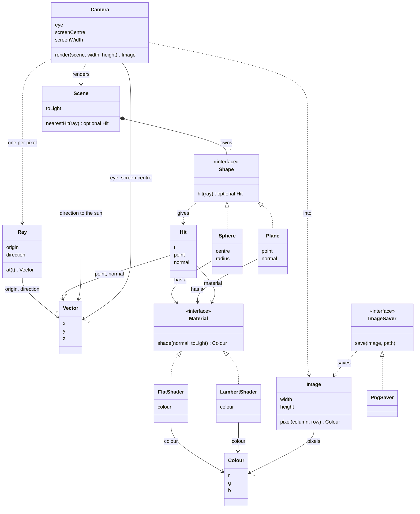

# Domain model

The concepts of the ray tracer and how they relate, in the client's words.
Methods are left out on purpose, except the few that say who does what.

## Decisions recorded so far

- **Is a colour a vector?** No, see [ADR 0007](../adr/0007-colour-is-its-own-class.md).
- **Are a point and a direction the same class?** For now yes: both are a `Vector`.
  Revisit if mixing them up causes bugs.
- **Is a shape a material, or does it have one?** It has one, and a material is a
  strategy: see [ADR 0010](../adr/0010-a-shape-has-a-material.md).
- **What does a hit tell?** `Shape::hit` gives a `Hit`: the `t` along the ray, the point,
  the unit normal pointing out of the surface and the material, or nothing on a miss.
  The hit is the nearest `t > 0`: a ray from inside a sphere hits its far side.
- **Which shape does a ray see?** `Scene::nearestHit` asks every shape and keeps the
  smallest `t`. The scene owns its shapes (`std::unique_ptr`); only `main` names
  `Sphere` and `Plane`, everything else depends on `Shape`.
- **What lights the scene?** The sun: one direction to the light, the same everywhere,
  held by the scene as a unit vector.
- **Who decides the colour of a pixel?** The free function `trace(ray, scene)` in
  `src/render/trace.h` takes the nearest hit; its material gives the colour from the
  normal and the direction to the sun (`shade(normal, toLight)`); a miss is black.
  `LambertShader` gives max(0, N . L) × colour; `FlatShader` gives its colour whatever
  the light.
- **Who makes the picture?** The camera renders the scene into an `Image`; it does not
  save itself: a saver saves it. `PngSaver` is the only saver today, behind the
  `ImageSaver` interface ([ADR 0008](../adr/0008-lodepng-for-png-output.md)).
- **How are pixels counted?** See [ADR 0009](../adr/0009-coordinates.md).

## Parked

- A shape refers to its material: the material must outlive the shape and the scene.
  Passing a temporary material does not compile.
- There are no shadows: no ray is cast from the hit point towards the sun yet.
- One light, a direction. A lamp at a position would need a light interface.
- The camera both builds rays and loops over pixels: two reasons to change.
- Each shape repeats the same `_material` member and constructor plumbing.
- `Image` does not check pixel bounds: an out-of-range column or row is undefined behaviour.
- Colours outside 0..1 do not fit in a byte when saved.
- `main` does not catch the saver's exception.

## Folder dependencies

`render/` → `scene/` → `geometry/` → `math/`; `geometry/` → `material/` → `colour/`, `math/`;
`render/` → `image/` ← `output/`. No cycle: `material/` does not know about `geometry/`.
