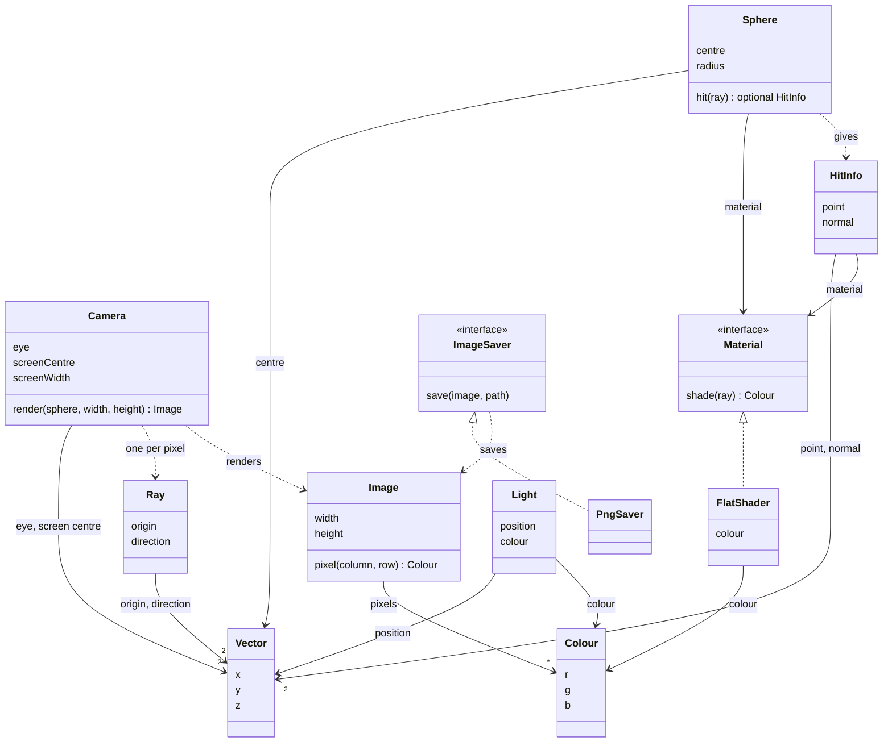

# Domain model

The concepts of the ray tracer and how they relate, in the client's words.
Methods are left out on purpose, except the few that say who does what.

## Decisions recorded so far

- **Is a colour a vector?** No, see [ADR 0007](../adr/0007-colour-is-its-own-class.md).
- **Are a point and a direction the same class?** For now yes: both are a `Vector`.
  Revisit if mixing them up causes bugs.
- **Who decides the colour of a pixel?** The free function `trace(ray, sphere)` in
  `src/render/trace.h` asks the sphere for a hit; the hit's `Material` gives the colour
  (`shade(ray)`); a miss is black. `FlatShader` gives one colour, whatever the ray.
- **What does a hit tell?** `Sphere::hit` gives a `HitInfo`: the point, the unit normal
  there and the material, or nothing on a miss. The hit is the nearest `t > 0`: a ray
  from inside the sphere hits its far side, and a ray starting exactly on the surface
  does not hit it again there.
- **Who makes the picture?** The camera renders the scene into an `Image`; it does not
  save itself: a saver saves it. `PngSaver` is the only saver today, behind the
  `ImageSaver` interface ([ADR 0008](../adr/0008-lodepng-for-png-output.md)).
- **How are pixels counted?** See [ADR 0009](../adr/0009-coordinates.md).

## Parked

- A `Sphere` refers to its material: the material must outlive the sphere. Passing a
  temporary material does not compile.
- `geometry/` and `material/` depend on each other (`Sphere` holds a `Material`, and
  `Material::shade` takes a `Ray`, `HitInfo` carries a `Material`). Revisit when
  `shade` takes the hit point and normal.
- `Image` does not check pixel bounds: an out-of-range column or row is undefined behaviour.
- Colours outside 0..1 do not fit in a byte when saved.
- `render` takes one concrete `Sphere`.
- `main` does not catch the saver's exception.
- A `Light` is a point light (a position and a colour). Nothing uses it yet: the scene
  is still lit by nothing, until the shading chapter.

## Folder dependencies

`render/` → `geometry/` → `math/`, `material/` → `colour/`, `render/` → `image/` ← `output/`, `light/` → `math/`, `colour/`.
One cycle, parked above: `geometry/` ↔ `material/`.
